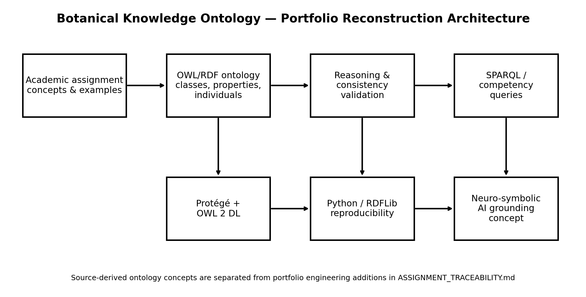
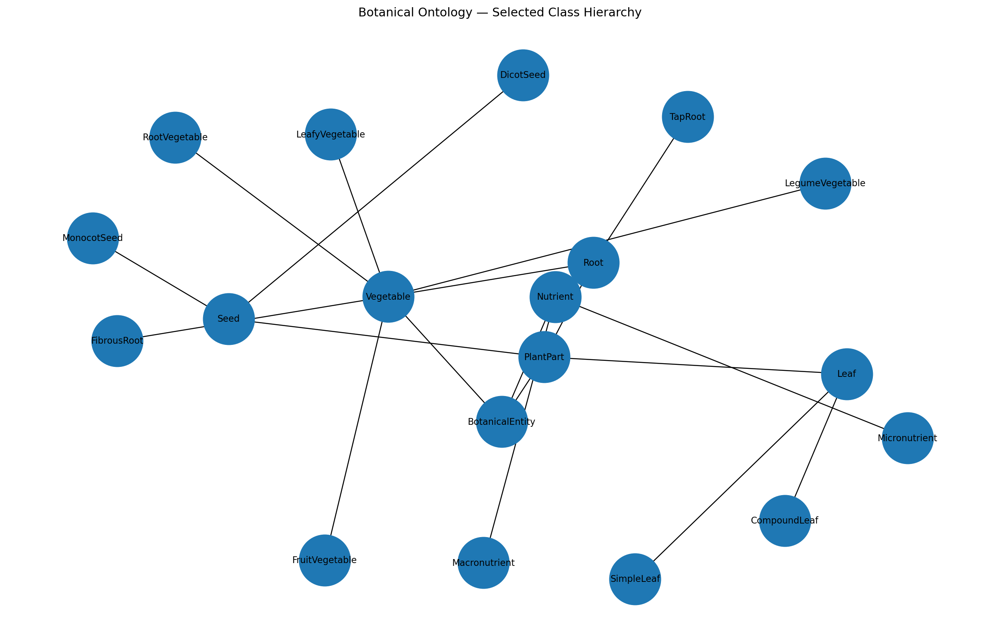

# Botanical Knowledge Ontology 🌱

**Knowledge Engineering · Semantic Web · OWL/RDF · SPARQL · Protégé-compatible · Neuro-symbolic AI concepts**

A reproducible portfolio reconstruction of an MSc Knowledge Engineering project that models botanical, agricultural and nutritional knowledge in a semantic ontology.

> **Transparency note:** the original Protégé/OWL file is no longer available. This repository was reconstructed from the written assignment and then extended with Python tooling, tests and documentation for portfolio use. Source-supported facts and portfolio additions are separated in [`docs/ASSIGNMENT_TRACEABILITY.md`](docs/ASSIGNMENT_TRACEABILITY.md).



## Why this project?

Botanical data is often split across taxonomic, agricultural and nutritional sources. The original assignment explored how an ontology can bridge those knowledge silos so that machines can reason across concepts such as plant structure, growth time and nutrition.

The reconstructed ontology connects:

- **Vegetable taxonomy** — root, leafy, legume and fruit vegetables.
- **Plant morphology** — roots, leaves, seeds, stems, fruits and related parts.
- **Nutrition** — macronutrient/micronutrient concepts and queryable nutritional properties.
- **Agricultural planning** — growth-time and crop-selection concepts.
- **Culinary context** — taste and usage relations.
- **Semantic reasoning** — disjointness, inverse relations and transitive part-whole modelling.

## Selected ontology structure



Key classes described in the assignment include:

```text
Vegetable
├── RootVegetable
├── LeafyVegetable
├── LegumeVegetable
└── FruitVegetable

PlantPart
├── Root
│   ├── TapRoot
│   └── FibrousRoot
├── Stem
├── Leaf
│   ├── SimpleLeaf
│   └── CompoundLeaf
└── Seed
    ├── MonocotSeed
    └── DicotSeed
```

The portfolio ontology also contains light supporting classes for nutrients, cuisines and reasoning-oriented query categories.

## Semantic relationships

The assignment described part-whole modelling and biological/culinary relationships. The reconstruction implements:

- `hasPart` — transitive object property
- `isPartOf` — inverse of `hasPart`
- `hasGrowthHabit`
- `hasFlower`
- `hasPod`
- `usedInCuisine`

Data properties include:

- `proteinPer100g`, `carbPer100g`, `fatPer100g`
- `caloriesPer100g`
- `hasVitaminA`, `hasVitaminC`, `hasVitaminK`
- `growthTimeDays`
- `hasOrigin`, `hasColor`, `hasTaste`

## Source-supported examples

The written assignment explicitly states that:

- `Carrot_ind` is a RootVegetable.
- Carrot has colour **Orange**.
- Carrot has a growth duration of **70 days**.
- Carrot has Vitamin A = **true**.
- Radish is used as a **25-day** growth example.
- Pumpkin is used as a **90-day** growth example.
- RootVegetable and LeafyVegetable are used as disjointness examples.
- MonocotSeed and DicotSeed are mutually exclusive.

Where the assignment reports a query result without giving its exact numeric inputs, this repository preserves the result using helper semantic classes instead of inventing missing measurements. See the traceability document for details.

## Competency-query examples

The repository includes SPARQL queries for:

1. Vitamin-A root vegetables.
2. Fast-growing crops identified by the assignment scenarios.
3. High-protein + fast-growing crop examples.
4. Known source-supported growth durations.
5. Leafy vegetables.
6. Part-whole relationships.

Run all examples with:

```bash
python src/query_ontology.py
```

## Assignment reasoning scenarios represented

### Biofortification
The original report describes a scenario where a researcher searches for Vitamin-A-rich root vegetables. The assignment says the reasoning result includes `Carrot_ind` and `SweetPotato_ind`, while excluding Vitamin-A-rich leafy crops such as Spinach.

### Crop succession
The report describes a query for crops that mature in under 60 days, returning examples including Bean and Beetroot. Because their exact growth-time assertions were not preserved in the report, this reconstruction represents that outcome with the `FastGrowingCrop` helper class rather than inventing exact day values.

### Neuro-symbolic grounding
The report proposes using the ontology as a ground-truth layer for an LLM. Its example asks for a high-protein crop that grows quickly and states that the ontology retrieves Spinach. The reconstruction preserves this as `Spinach_ind` belonging to both `HighProteinCrop` and `FastGrowingCrop`.

## Open in Protégé

The repository includes both formats:

- [`ontology/botanical_ontology.owl`](ontology/botanical_ontology.owl) — RDF/XML, convenient for Protégé.
- [`ontology/botanical_ontology.ttl`](ontology/botanical_ontology.ttl) — Turtle, easier to read and review in Git.

Open either file in Protégé. For full OWL DL classification, use a DL reasoner such as Pellet or HermiT.

## Rebuild the ontology

Install dependencies:

```bash
python -m venv .venv
```

Windows:

```bash
.venv\Scripts\activate
```

macOS/Linux:

```bash
source .venv/bin/activate
```

Then:

```bash
pip install -r requirements.txt
python src/build_ontology.py
```

This regenerates the Turtle, RDF/XML and JSON-LD exports.

## Validate

```bash
python src/validate_ontology.py
pytest -q
```

The validator checks required classes/properties, source-supported facts, disjointness violations, basic numeric integrity and inverse part-whole assertions.

## Generate diagrams

```bash
python src/export_graph.py
```

## Repository structure

```text
botanical-knowledge-ontology/
├── ontology/
│   ├── botanical_ontology.ttl
│   ├── botanical_ontology.owl
│   └── botanical_ontology.jsonld
├── data/
│   └── source_supported_facts.csv
├── queries/
│   └── *.sparql
├── src/
│   ├── build_ontology.py
│   ├── query_ontology.py
│   ├── validate_ontology.py
│   └── export_graph.py
├── tests/
│   └── test_ontology.py
├── docs/
│   ├── ASSIGNMENT_TRACEABILITY.md
│   ├── ONTOLOGY_DESIGN.md
│   └── PORTFOLIO_NOTES.md
├── assets/
│   ├── class_hierarchy.png
│   └── project_architecture.png
└── .github/workflows/tests.yml
```

## Academic-to-portfolio reconstruction

This repository does not pretend to be the exact historical submission. The reconstruction deliberately distinguishes:

- **Assignment-explicit facts** — directly stated in the report.
- **Assignment-inferred facts** — required by query outcomes reported in the assignment.
- **Portfolio additions** — code, tests, diagrams and repository engineering added later for reproducibility.

That distinction is documented in [`data/source_supported_facts.csv`](data/source_supported_facts.csv) and [`docs/ASSIGNMENT_TRACEABILITY.md`](docs/ASSIGNMENT_TRACEABILITY.md).

## Future extensions

The original assignment discussed several directions that can be taken further:

- Link the ontology more formally to AGROVOC and FoodOn identifiers.
- Add verified USDA FoodData Central nutrition values with provenance.
- Integrate real-time IoT observations for a plant digital twin.
- Add a retrieval layer so an LLM queries the ontology before producing agricultural or nutritional recommendations.
- Build a small API or web interface for natural-language-to-SPARQL queries.

## Author

**Minhajul Abedin**  
MSc Computer Science & Technology — Ulster University, London

## License

MIT License. See [`LICENSE`](LICENSE).
